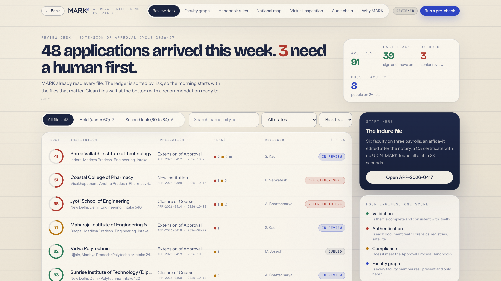
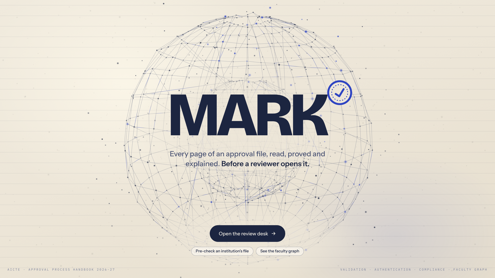
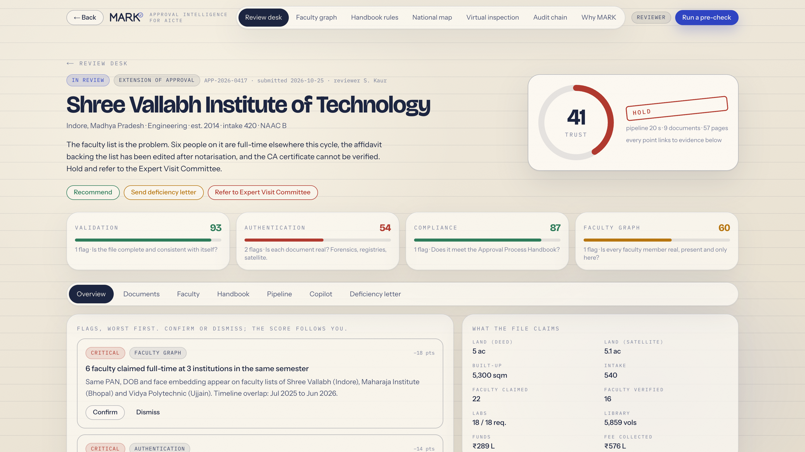
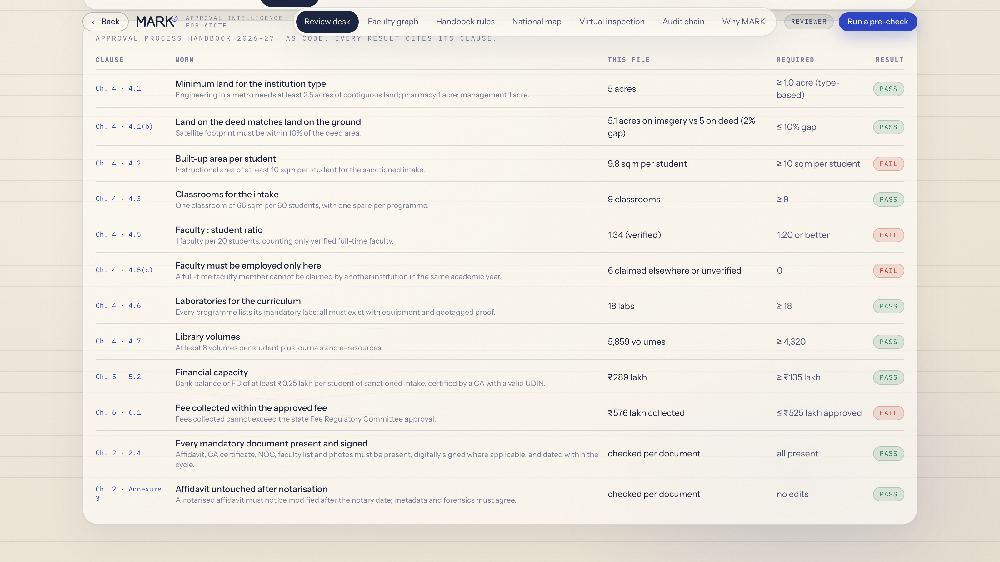
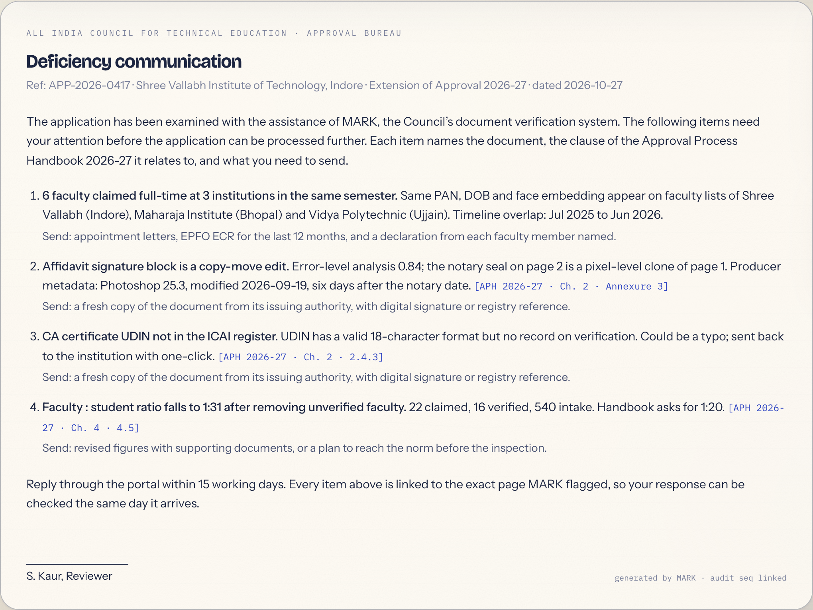
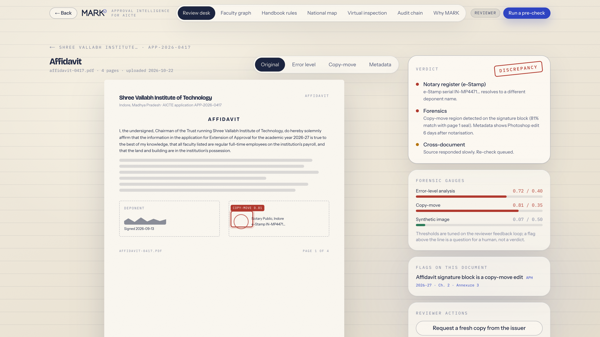
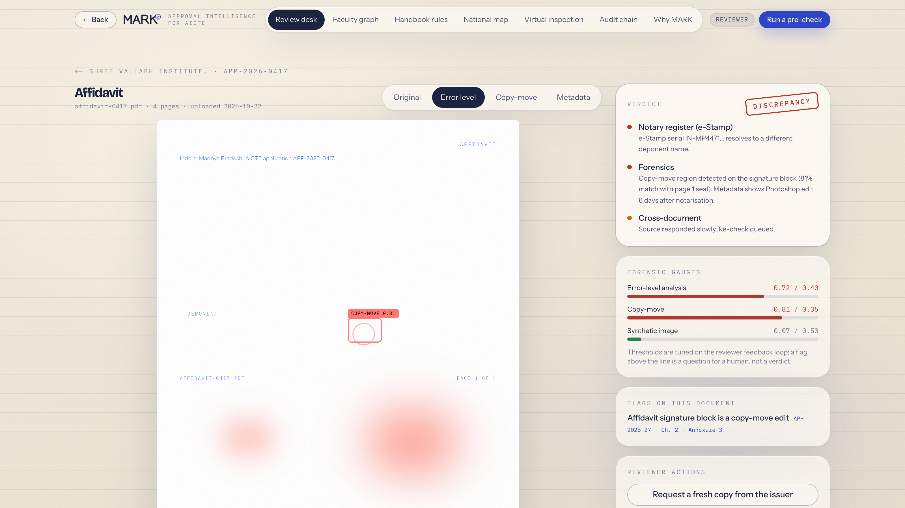
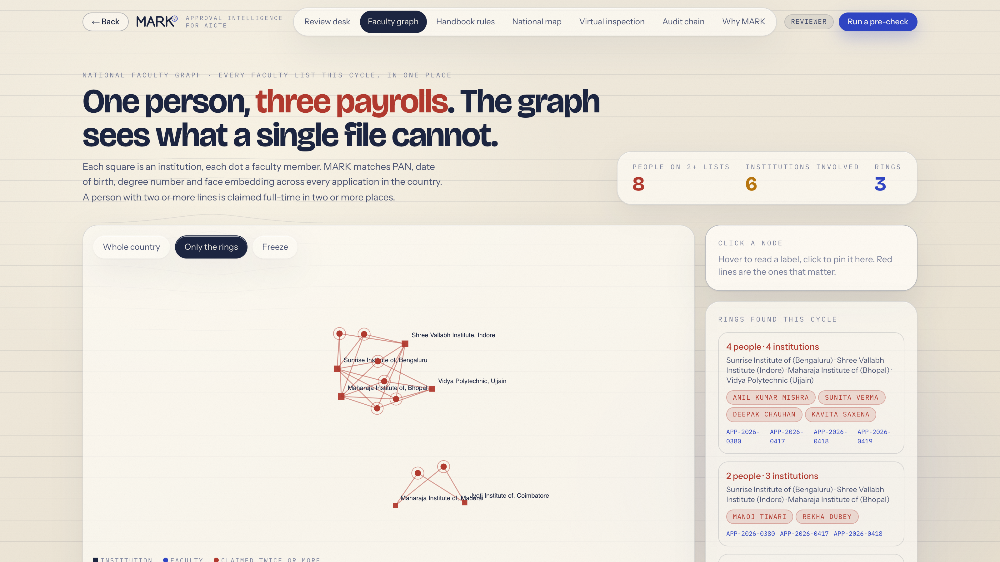
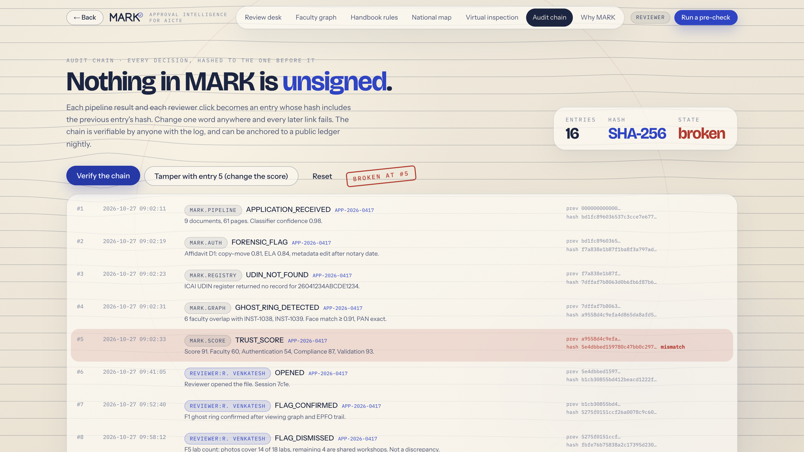

# MARK

**Multi-source Authentication and Regulatory Knowledge.**
AI-powered application validation, document authentication and regulatory compliance verification for AICTE.



## The problem

Every year AICTE receives thousands of approval applications from engineering, pharmacy, management, polytechnic and architecture institutions. Each application is a bundle of 40 to 60 documents: affidavits, land deeds, building plans, faculty lists, CA certificates, NOCs, bank statements, geotagged photos.

Reviewers check one file at a time, by hand. Three things slip through:

- **Edited documents.** A notarised affidavit changed after the notary date, a bank statement with a pasted-in balance, a plan with a re-drawn boundary.
- **Ghost faculty.** The same person, with the same PAN, date of birth and photo, appearing on the faculty list of three institutions in the same academic year. A single file can never reveal this.
- **Handbook drift.** The Approval Process Handbook changes every cycle. Norms live in a PDF, not in the checker, so each reviewer applies them slightly differently.

## What MARK does

MARK reads every document in an application, proves each one is real, checks the file against the handbook, and compares it with every other application in the country. Then it shows the reviewer exactly why, with the page, the clause and the registry response next to every flag.

MARK never says "fraud". It says discrepancy, unverified, needs a fresh copy. A question, not a verdict. The machine proposes, a person decides, and the record shows both.

### Four engines, one trust score

| Engine | Question it answers | Evidence it uses |
| --- | --- | --- |
| **Validation** | Does every document agree with every other document? | Cross-document field extraction, completeness, dates within the cycle |
| **Authentication** | Is each document real and untouched? | Error-level analysis, copy-move detection, font breaks, metadata, synthetic-image score, and registry calls to UDIN, EPFO, DigiLocker, Bhulekh and university NOC |
| **Compliance** | Does the institution meet the handbook norms? | 14 norms written as code, each tagged with its handbook clause and version |
| **Faculty** | Is every claimed faculty member real, full-time and only here? | A national faculty graph on PAN, date of birth, degree, face and EPFO timeline across all institutions |

The four scores are weighted into one trust score. Every point lost links back to a flag, and every flag links to the page and the source that produced it. A reviewer can confirm or dismiss a flag and watch the score recompute.

### The pipeline

```
Intake → Classify → Read (OCR, Indic) → Extract → Cross-check → Forensics
      → Registries → Faculty graph → Handbook rules → Trust score → Audit chain
```

Every decision is hashed to the previous one (SHA-256). The chain can be verified in the browser, and tampering with any entry breaks everything after it.

## Screens

| | |
| --- | --- |
|  |  |
| The opening | One application: score ring, four engines, flags with evidence |
|  |  |
| Handbook table, every norm with its clause | Deficiency letter drafted from the flags |
|  |  |
| The affidavit as submitted | The same page under the error-level lens |
|  |  |
| National faculty graph, ghost ring in red | Audit chain after one entry is tampered with |

## Routes

| Route | What it shows |
| --- | --- |
| `/` | The opening. An ink web blooms behind the MARK wordmark, the seal stamps the K. |
| `/review` | The reviewer's desk. 48 applications sorted by risk, filters by band and state. |
| `/review/[id]` | One application: trust score ring, four engine scores, flags with evidence and clauses (confirm or dismiss and the score recomputes), documents, faculty, handbook table, pipeline replay, copilot chat, deficiency letter. |
| `/review/[id]/doc/[docId]` | The document rendered as paper, with a hover lens for the forensic layer and toggles for error-level, copy-move and metadata. |
| `/graph` | The national faculty graph. Force layout on canvas; people on two or more faculty lists are drawn in red. |
| `/rules` | The handbook as versioned code. A clause-to-rule draft with a human approval step. |
| `/precheck` | The institution's rehearsal: drop files, see what is missing, run the same pipeline before submitting. |
| `/map` | A tile-grid map of India with average trust per state. |
| `/inspect` | Virtual inspection: a phone walkthrough that MARK counts (classrooms, labs, seats). |
| `/audit` | The SHA-256 hash chain of every decision, verifiable in the browser. Tamper with one entry and watch it break. |
| `/settings` | Role, thresholds, integrations, privacy. |
| `/about` | Why MARK, the architecture, the five-minute demo script. |

## The hero file

`APP-2026-0417`, Shree Vallabh Institute, Indore. Six faculty members form a ring across institutions in Indore, Bhopal and Ujjain. The affidavit was edited after notarisation. The CA certificate carries no UDIN. Trust score around 41. Open it from the desk and every flag walks you to its evidence.

## Run it

```sh
cd app
npm install
npm run dev          # http://localhost:3900
```

Or build once and serve:

```sh
cd app
./run.sh             # production build + serve on :3900
```

### Optional: live copilot

Copy `app/.env.example` to `app/.env.local` and fill in a messages endpoint. The reviewer copilot and deficiency letters are then written by the language model, grounded only in the file, the registry responses and the handbook.

```
LLM_API_URL=        # a messages endpoint that accepts { model, system, messages, max_tokens }
LLM_API_KEY=
LLM_MODEL=
LLM_API_HEADERS=    # optional JSON, for providers that need a version header
```

Without these the copilot answers from a scripted engine that reads the same data. Both paths work offline.

## Stack

- **Next.js 16** (App Router, Turbopack), **React 19**, **Tailwind 4**. Plain JavaScript, no TypeScript.
- **Motion** (Framer Motion) for reveals and page transitions, **GSAP** for the intro timeline, counters and the pipeline strip, **Three.js** for the ink web on the opening.
- No scroll-driven animation anywhere. Everything plays on mount or on action.
- Design: warm manila paper, ink-blue pen, a stamp seal. Fonts Bricolage Grotesque, Instrument Sans, IBM Plex Mono.

### Project layout

```
app/
  app/            routes (page.jsx per route, api/copilot/route.js)
  components/     Shell, Copilot, DocPaper, Pipeline, InkWeb, Logo, ui
  lib/
    data.js       48 synthetic applications, institutions, faculty, documents
    rules.js      14 handbook norms as code, each with clause and version
    audit.js      the decision log that feeds the hash chain
ppt-shots/        screenshots used in the deck and this README
MARK-Product-and-Build-Guide.pdf   full product and build guide
```

## Data and integrations

Everything in the demo is synthetic and deterministic, generated in `app/lib/data.js`. No real institution, person, PAN or document appears anywhere.

Registries (UDIN, EPFO, DigiLocker, Bhulekh, NAD), satellite imagery (Bhuvan) and the AICTE portal are mocked. The response shapes match the real services, so each mock is a single adapter away from the live integration.

## Production architecture

1. **Intake**: portal pull, DigiLocker, drag-and-drop, into an object store.
2. **Read**: classifier, Indic OCR, layout extraction, every field tagged with its page and bounding box.
3. **Validate**: cross-document consistency, completeness, dates in cycle.
4. **Authenticate**: forensics (ELA, copy-move, fonts, metadata, synthetic images), registry calls, satellite and EXIF geo.
5. **Faculty graph**: PostgreSQL plus a graph store, PAN/DOB/degree/face matching, timeline overlap.
6. **Comply**: handbook rules as code, versioned per cycle, LLM-drafted and human-approved.
7. **Score and explain**: weighted, explained, evidence-linked; LLM grounded in the file for chat and letters.
8. **Trust**: SHA-256 audit chain, DPDP controls, bias guard, reviewer feedback loop.

## Problem statement

Smart India Hackathon 2026, problem statement **SIH26261**: AI-powered application validation, document authentication and regulatory compliance verification for AICTE.
